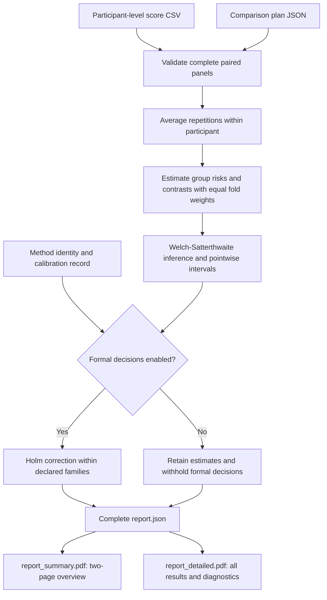

# Group Privacy Audit for Eye-Tracking Identification

**Assess who remains identifiable after protection, how group gaps change, and which differences receive statistical support.**

This pipeline turns participant-level identification scores and a declared comparison plan into **two English PDF reports**: a two-page summary for quick review and a detailed report with every comparison. Charts show group risks and differences; statistical results retain confidence intervals, raw p-values and Holm-adjusted p-values. A JSON report preserves the complete machine-readable output.

The tool helps researchers compare privacy-protection settings across groups. It analyzes existing scores supplied by users and runs locally without uploading inputs or results.

## Pipeline



Both reports use the same saved results. Rendering does not rerun the analysis, change p-values or redefine comparison families.

## Quick start

Use Python 3.11 or later. Run these commands from the repository root:

```bash
python -m pip install -r requirements.txt
python -m scripts.run_robust_privacy_audit --scores examples/privacy_pipeline_scores.csv --plan configs/privacy_pipeline_blocked_example.json --output results/example_audit
```

The output directory must be new.

| Output | Purpose |
|---|---|
| `report_summary.pdf` | Two pages: main findings first, a before/after group-gap chart and corrected-decision graphics. |
| `report_detailed.pdf` | All group-rate charts, effects, pointwise intervals, raw and adjusted p-values, interpretations and diagnostics. Length depends on the plan. |
| `report.json` | Complete numerical results, plan, calibration status and input hash. |

These files appear in `results/example_audit/`. The small bundled example includes a withheld zero-variance decision. For a more informative report with 200 simulated participants and several protection settings, run:

```bash
python examples/generate_illustrative_scores.py --output results/illustrative_inputs
python -m scripts.run_robust_privacy_audit --scores results/illustrative_inputs/synthetic_scores.csv --plan results/illustrative_inputs/plan.json --output results/illustrative_audit
```

Both examples are entirely synthetic. The second uses a fixed seed to demonstrate reports; it is not a calibration experiment. Synthetic reports carry a small sample-data note in the footer.

## Reading the reports

The summary opens with two large, red statements describing the observed baseline gap and whether its magnitude becomes larger or smaller after protection. They describe numerical estimates, not a separate test of baseline significance. The first-page chart compares baseline gaps with the range of protected-condition gaps. Its segments show observed ranges, **not confidence intervals**. For more than five dataset/model panels, the summary shows four individually and combines the remaining panels into a clearly labeled range; the detailed report retains every panel.

The second page separates supported, not-supported and withheld decisions. Residual-gap and baseline-change comparisons appear on separate display rows but remain in their original shared correction family. Empty mechanism or utility families are omitted. The summary is limited to two pages without removing comparisons from the detailed report or JSON.

Use the detailed report to check exact settings, signed effects, pointwise 95% confidence intervals, raw p-values and adjusted p-values. A positive A-minus-B gap means group A has a higher estimated identification rate. A signed gap change is the protected gap minus the baseline gap; this differs from a change in absolute gap magnitude when direction reverses. A result that does not pass correction does not establish equal protection.

## Use your own scores

```bash
python -m scripts.run_robust_privacy_audit --scores path/to/scores.csv --plan path/to/plan.json --output results/my_audit
```

| CSV column | Meaning |
|---|---|
| `subject_id` | Stable participant identifier across conditions. |
| `fold` | Test fold, numbered 0 through 4. |
| `group` | Recorded group label; the plan specifies the ordered pair. |
| `evaluator` | Identification model or evaluation setting. |
| `condition` | Baseline, protection or control condition named in the plan. |
| `replicate` | Paired repetition ID, aligned across conditions. |
| `rank1_ir` | Finite Rank-1 identification percentage from 0 to 100. |
| `dataset` | Optional dataset ID for combining datasets. |
| `utility` | Optional utility score, complete and shared across evaluators. |

Each target group needs at least two participants in each of five folds. Each evaluator must have the same complete participant set and paired repetitions in every condition. Repetitions are averaged within participant; folds then receive equal weight. Participants outside the target pair may remain in the score table and overall summaries. Users remain responsible for valid collection, training/test separation and gallery construction.

Start from [the example plan](configs/privacy_pipeline_blocked_example.json). Define the baseline, conditions, ordered pair, controls and optional mechanism pairs before analysis. The `scope` field describes intended use and appears in the report; include `synthetic` for generated examples to enable the sample footer.

The current schema uses version 2, alpha 0.05 and Holm correction. Fields `seed`, `n_boot` and `n_perm` are retained for compatibility and do **not** control this approximate t-based method. The validator requires positive, matching `n_boot` and `n_perm`.

## Statistical outputs

The audit keeps three separately corrected families:

1. **Mechanism comparisons:** the first declared condition's group gap minus the second's.
2. **Residual gaps and baseline changes:** protected A-minus-B gaps and paired changes from baseline, corrected together.
3. **Utility comparisons:** paired utility differences for declared condition pairs.

The estimator uses group-by-fold variances and Welch-Satterthwaite approximate t inference. Intervals are pointwise, not simultaneous. A zero-variance test remains in its Holm family with p = 1 for correction; its individual p-value and formal decision are withheld. Diagnostic flags, including near-chance identification and fold-direction differences, do not veto residual-risk results.

The included score-level calibration record is checked against the inference source. Missing calibration or a changed method disables formal decisions while retaining estimates. Inference is conditional on fitted models and observed galleries and assumes independent participants. The calibration record does not establish independence under shared-gallery or overlapping-training dependence, or familywise error control for every new plan. This tool does not establish equivalence, demographic causation, a privacy guarantee or a strongest-attack bound. Noise-aware model training and scoring are separate from this score-table audit.

## Regenerate reports from saved results

Generate both PDFs without recomputing statistics:

```bash
python -m scripts.render_audit_report --input results/my_audit/report.json --output-dir results/my_audit_english_reports
```

Existing PDFs are never overwritten. If rendering fails during an audit, the command reports the error and preserves the completed JSON. Use the rendering command after resolving the issue. Both PDFs are rendered before either is copied to the destination. Choose a new directory if either output already exists.

The earlier single-PDF command remains available:

```bash
python -m scripts.render_audit_report --input results/my_audit/report.json --output results/my_audit_detailed_copy.pdf
```

This legacy `--output` command produces only a detailed report. The analysis command now names its detailed output `report_detailed.pdf`, replacing `report.pdf`.

English is the default for both reports and all examples. Fonts are embedded so text remains searchable and copyable. Use `--report-font path/to/font.ttf` for labels requiring a different Unicode font. The existing `--report-language zh` option remains available for Chinese headings and interpretations; user labels and technical metadata retain their original language.

## Repository contents and data privacy

```text
configs/     Example comparison plan
examples/    Synthetic scores, saved example result and generator
scripts/     Input validation, audit entry point and PDF renderers
src/         Calibrated statistical inference
dev/         Aggregate calibration evidence
tests/       Inference, portability and report-generation checks
```

This repository contains code, documentation, synthetic examples and aggregate calibration evidence. It contains no participant-level study scores, raw eye-tracking recordings, model weights, private reports or unpublished manuscripts. The `results/` and `audit_output/` directories are ignored by Git. Store your own inputs and reports in an appropriately protected location; an ignore rule is not access control.

## Verification

```bash
python -m unittest discover -s tests -p 'test_*.py' -v
```

Tests cover calibrated inference, LF/CRLF source identity, preserved results, withheld decisions, paired outputs, overwrite protection and large-plan summaries. The page-count test uses Poppler's `pdfinfo` when installed and otherwise reports a skip. PDF rendering requires ReportLab; the default English font is bundled with it.

`src/fairness/robust_inference.py` is retained from the calibrated study implementation. The CSV loader was extracted from the study adapter without unused historical analysis functions. Report generation is a presentation layer over the saved method output.
